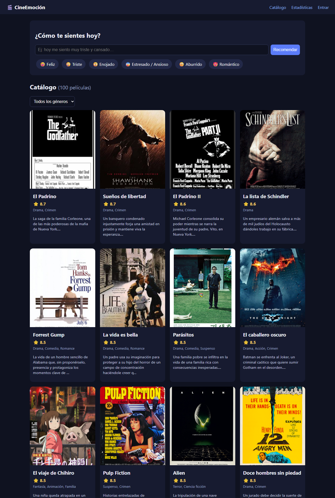
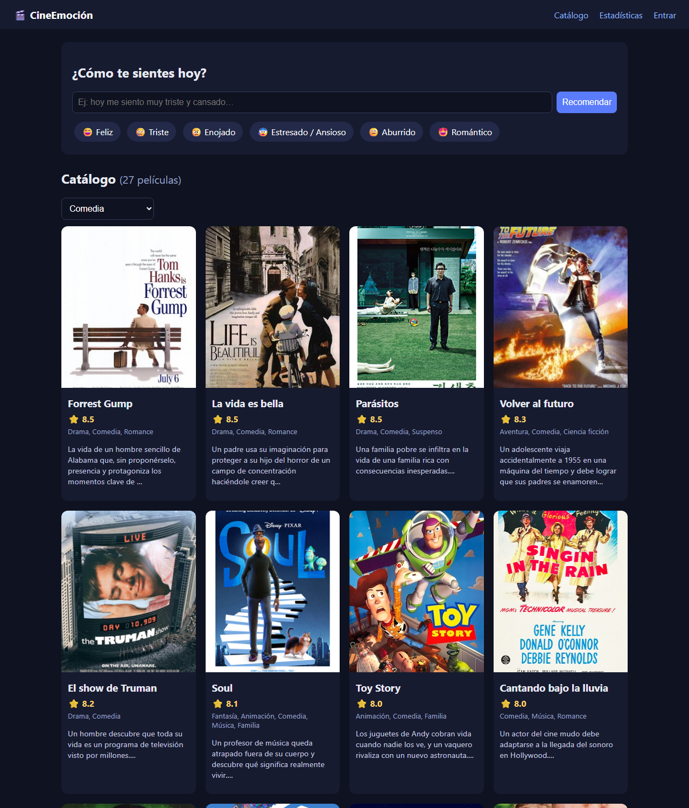
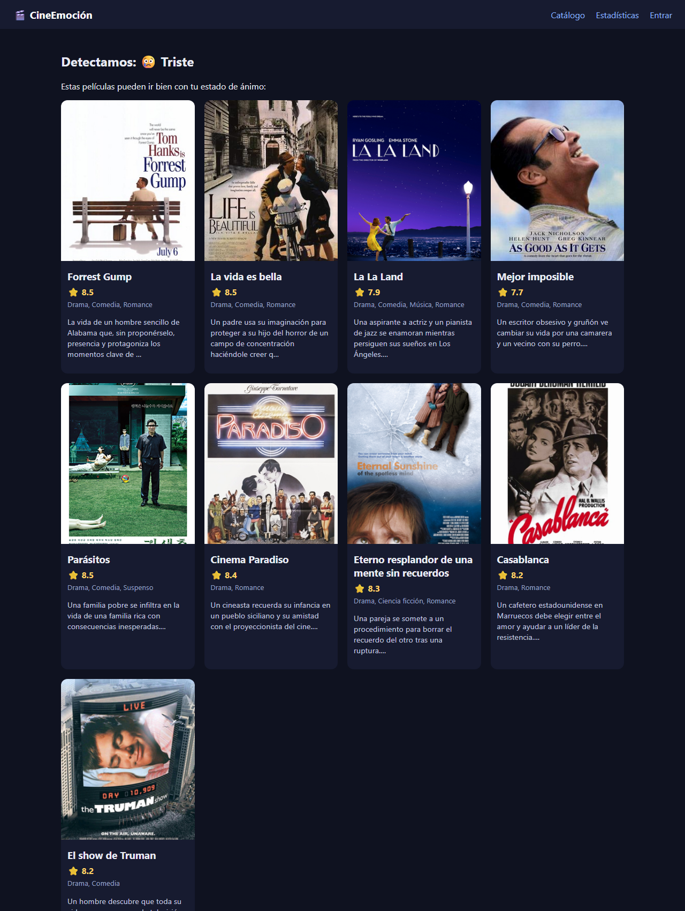
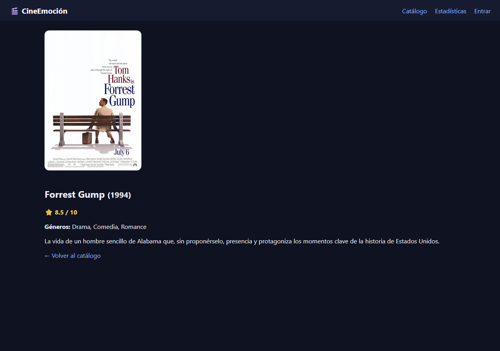
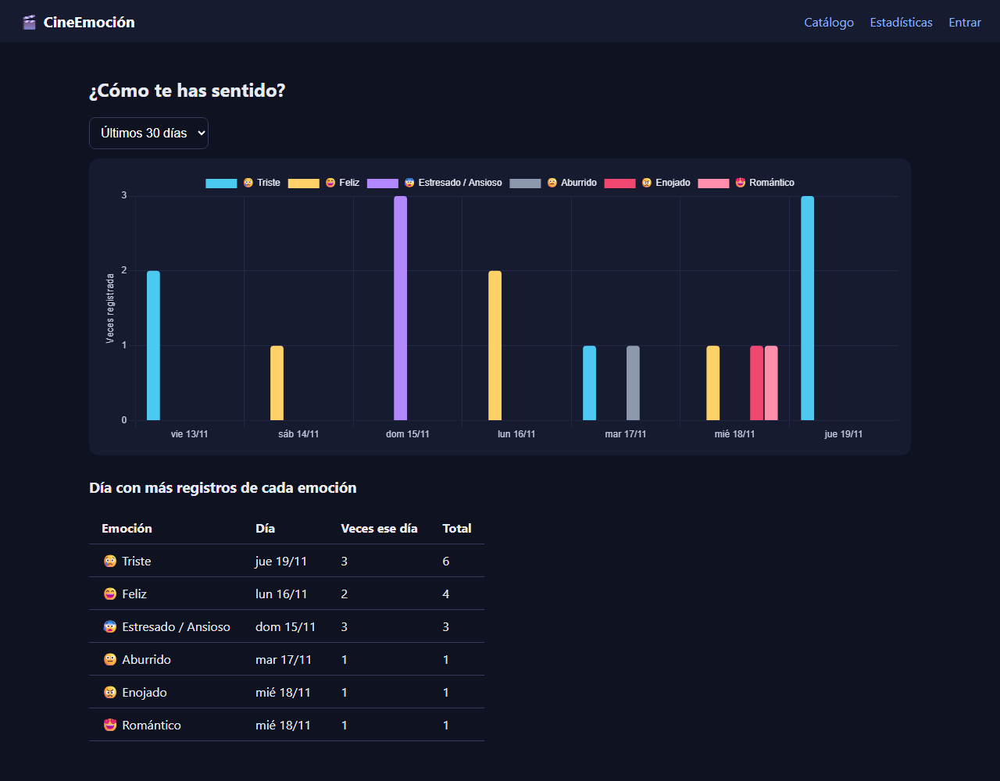
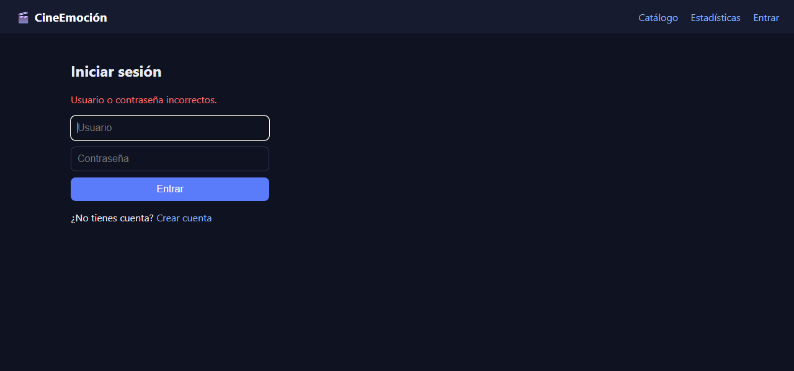
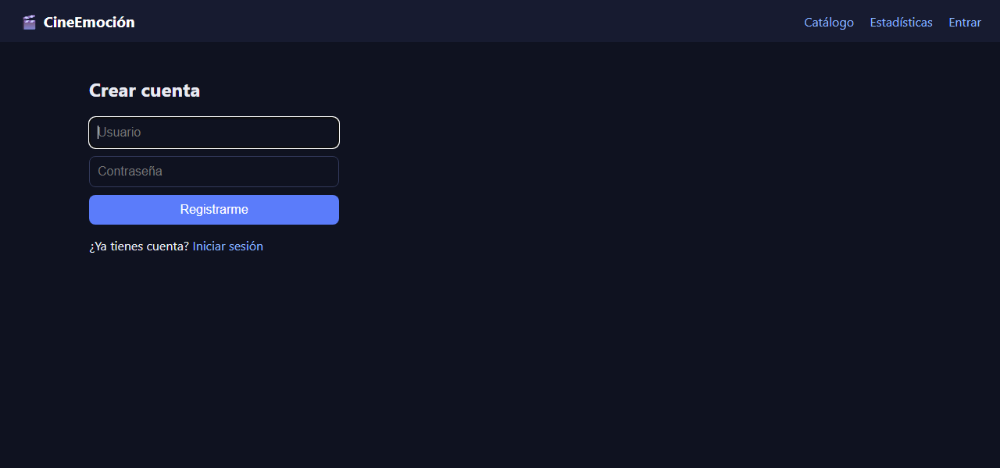
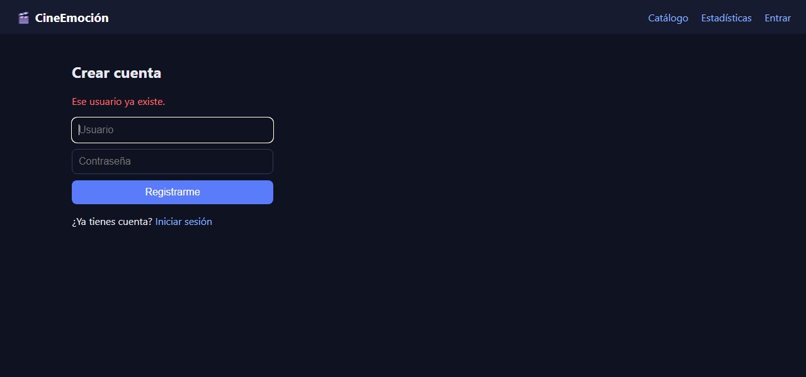
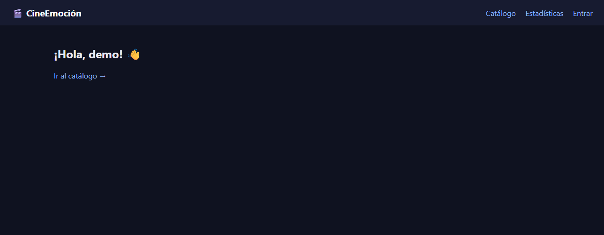

# 🎬 CineEmoción – Recomendador de películas según tu emoción

Proyecto universitario con **frontend y backend separados**, ambos en **Flask**, y base de datos **MySQL**.
El usuario escribe cómo se siente (o pulsa una emoción), el backend detecta la emoción por palabras clave
y recomienda películas según los géneros asociados a esa emoción.

```
Navegador ──► FRONTEND (Flask, :5000) ──HTTP/JSON──► BACKEND (Flask API, :5001) ──► MySQL (:3306)
```

## Estructura
```
cine-emocion/
├── docker-compose.yml        MySQL listo para usar (carga backend/sql/*.sql)
├── requirements.txt          instala backend + frontend de una vez
├── backend/                  API REST + base de datos
│   ├── app.py                endpoints JSON, paginado (skip/limit) y rate limit
│   ├── db.py, config.py      conexión MySQL (PyMySQL) y variables de entorno
│   ├── emotion.py            detector de emoción por palabras clave
│   ├── sql/                  schema.sql y seeds (100 películas)
│   └── static/posters/       imágenes de los pósters
└── frontend/                 sitio web
    ├── app.py                páginas; pide los datos al backend con requests
    ├── templates/            HTML (Jinja2)
    └── static/               CSS y Chart.js
```

## Vistas del frontend

Capturas de cada pantalla de CineEmoción (frontend en http://127.0.0.1:5000).

### 1. Catálogo (`/`)


Página principal. Tiene dos partes:
- **¿Cómo te sientes hoy?**: un campo de texto libre (ej. "hoy me siento muy triste y cansado") con el botón *Recomendar*, y atajos de un clic para las 6 emociones: Feliz, Triste, Enojado, Estresado/Ansioso, Aburrido y Romántico.
- **Catálogo** con las 100 películas ordenadas de mejor a peor puntuación, en tarjetas con póster, nota, géneros y sinopsis. Está **paginado** de 12 en 12.

### 2. Catálogo filtrado por género (`/?genero=35`)


El selector **Todos los géneros** filtra el catálogo por género (aquí, Comedia: 27 películas). El contador y la paginación se ajustan al filtro.

### 3. Recomendación según la emoción (`/recomendar`)


Muestra la emoción detectada ("Detectamos: 😳 Triste") y las películas sugeridas para ese estado de ánimo. La emoción sale del texto escrito (detección por palabras clave) o del botón pulsado. Las películas se ordenan por cuántos géneros de la emoción comparten y, si empatan, por puntuación. Cada consulta queda guardada en el historial que alimenta las estadísticas.

### 4. Detalle de película (`/pelicula/<id>`)


Al pulsar una tarjeta se ve el póster grande, título y año, puntuación sobre 10, géneros y sinopsis completa, con un enlace para volver al catálogo.

### 5. Estadísticas (`/estadisticas`)


Gráfico de barras (Chart.js) con las veces que se registró cada emoción por día, y una tabla con el **día con más registros de cada emoción** y su total. El selector de periodo (por defecto, últimos 30 días) cambia el rango. Las barras salen del historial de búsquedas (los datos de ejemplo están en `backend/sql/seed_demo_busquedas.sql`).

### 6. Iniciar sesión (`/login`)


Formulario de **usuario y contraseña**. Hay un usuario precargado: `demo` / `demo1234`.



Si los datos no son correctos se muestra "Usuario o contraseña incorrectos".

### 7. Crear cuenta (`/registro`)


Permite crear un usuario nuevo (3 a 50 caracteres de usuario, mínimo 4 de contraseña, guardada con hash).



Valida que el usuario no exista: si ya está tomado, avisa "Ese usuario ya existe".

### 8. Bienvenida


Tras iniciar sesión o registrarse con éxito se muestra "¡Hola, usuario!" con un enlace al catálogo. El login solo valida las credenciales; no mantiene una sesión abierta.

## Modelo de datos y JOINs
```
movies ──< movie_genres >── genres ──< emotion_genres >── emotions ──< searches
```
- **Catálogo**: `movies JOIN movie_genres JOIN genres` (géneros de cada película).
- **Recomendación**: `emotions JOIN emotion_genres JOIN movie_genres JOIN movies`,
  ordenado por cantidad de géneros coincidentes y puntuación.
- **Estadísticas**: `searches JOIN emotions` + `GROUP BY` día y emoción (gráfico de barras).

## Cómo ejecutarlo
1. Base de datos: `docker compose up -d`
   (o con MySQL local: cargar en orden `backend/sql/schema.sql`, `seed.sql`, `seed_extra.sql`, `seed_extra2.sql`, `seed_extra3.sql`, `seed_users.sql`, `seed_posters.sql`)
2. Entorno Python (una sola vez):
   ```bash
   python3 -m venv venv && source venv/bin/activate
   pip install -r requirements.txt
   cp backend/.env.example backend/.env      # ajusta usuario/clave de MySQL
   cp frontend/.env.example frontend/.env
   ```
3. Backend (terminal 1):  `cd backend && python app.py`   → http://127.0.0.1:5001
4. Frontend (terminal 2): `cd frontend && python app.py`  → **http://127.0.0.1:5000**

## Endpoints del backend
| Método | Ruta | Descripción |
|---|---|---|
| GET | `/api/peliculas?skip=0&limit=12&genero=35` | catálogo paginado (`total`, `tiene_mas`, `items`) |
| GET | `/api/peliculas/<id>` | detalle de una película |
| GET | `/api/generos`, `/api/emociones` | listas auxiliares |
| POST | `/api/recomendar` | `{"texto": "estoy triste"}` o `{"emocion": "triste"}`; guarda en el historial |
| GET | `/api/recomendar/<emocion>` | recomendación sin guardar historial |
| POST | `/api/emocion` | `{"texto": "..."}` → emoción detectada |
| GET | `/api/estadisticas?dias=30` | datos para el gráfico por día |

Rate limit: 60–120 peticiones por minuto por IP (responde `429` con `Retry-After`).

## Pósters
Las imágenes ya están descargadas en `backend/static/posters/` y la tabla `movies` guarda su ruta en `poster_url`.

## Datos de ejemplo para el gráfico (opcional)
`backend/sql/seed_demo_busquedas.sql` inserta búsquedas ficticias (`[demo]`).
Para borrarlas: `DELETE FROM searches WHERE text LIKE '[demo]%';`

## Login
Usuario precargado: **demo** / **demo1234**. Desde `/registro` se pueden crear más (no permite usuarios repetidos).
