# 🎬 CineEmoción – Recomendador de películas según tu emoción

Proyecto universitario con **frontend y backend separados**, ambos en **Flask**, y base de datos **MySQL**.
El usuario escribe cómo se siente (o pulsa una emoción), el backend detecta la emoción por palabras clave
y recomienda películas según los géneros asociados a esa emoción.

```
Navegador ──► FRONTEND (Flask, :5000) ──HTTP/JSON──► BACKEND (Flask API, :5001) ──► MySQL (:3306)
```

## Estructura
```
cine-emocion/
├── docker-compose.yml        MySQL listo para usar (carga backend/sql/*.sql)
├── requirements.txt          instala backend + frontend de una vez
├── backend/                  API REST + base de datos
│   ├── app.py                endpoints JSON, paginado (skip/limit) y rate limit
│   ├── db.py, config.py      conexión MySQL (PyMySQL) y variables de entorno
│   ├── emotion.py            detector de emoción por palabras clave
│   ├── sql/                  schema.sql y seeds (100 películas)
│   └── static/posters/       imágenes de los pósters
└── frontend/                 sitio web
    ├── app.py                páginas; pide los datos al backend con requests
    ├── templates/            HTML (Jinja2)
    └── static/               CSS y Chart.js
```

## Vistas del frontend

Capturas de cada pantalla de CineEmoción (frontend en http://127.0.0.1:5000). El diseño usa una paleta cálida de cine (fondo oscuro con acentos dorado y rosa), tipografía Fraunces para los títulos y un color propio para cada emoción.

### 1. Iniciar sesión (`/`)
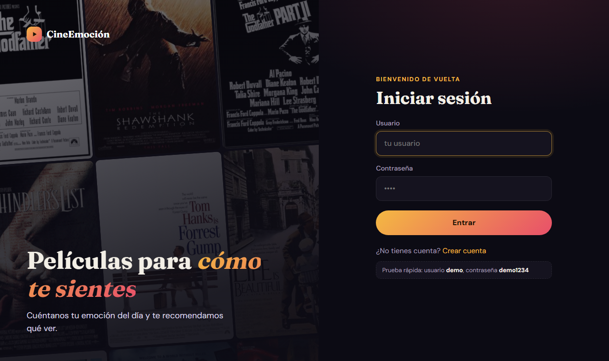

Pantalla de entrada dividida en dos mitades:
- **Izquierda**: imagen del sistema, un mosaico con los pósters de las películas mejor puntuadas y el lema "Películas para cómo te sientes".
- **Derecha**: formulario de **usuario y contraseña**. Hay un usuario precargado: `demo` / `demo1234`.

Al entrar con éxito se pasa al cuestionario. Si los datos no son correctos se muestra "Usuario o contraseña incorrectos":

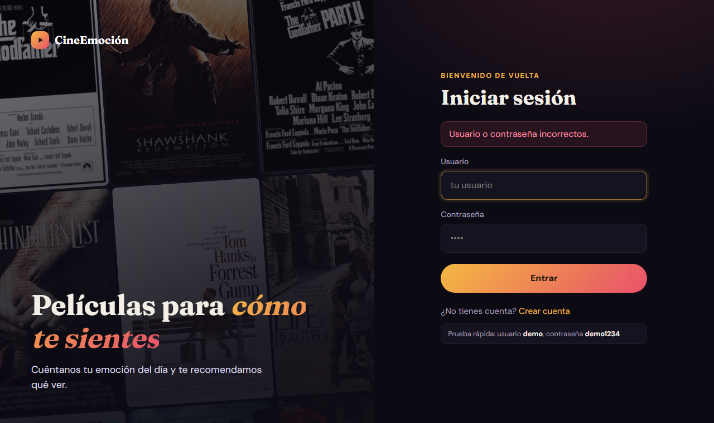

### 2. Crear cuenta (`/registro`)
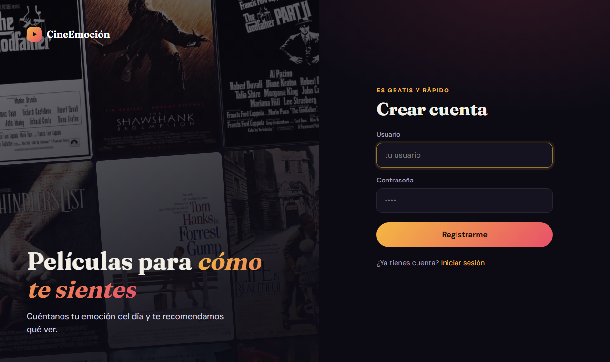

Misma pantalla dividida para crear un usuario nuevo (3 a 50 caracteres de usuario, mínimo 4 de contraseña, guardada con hash). Tras registrarse entra directo al cuestionario. Valida que el usuario no exista:

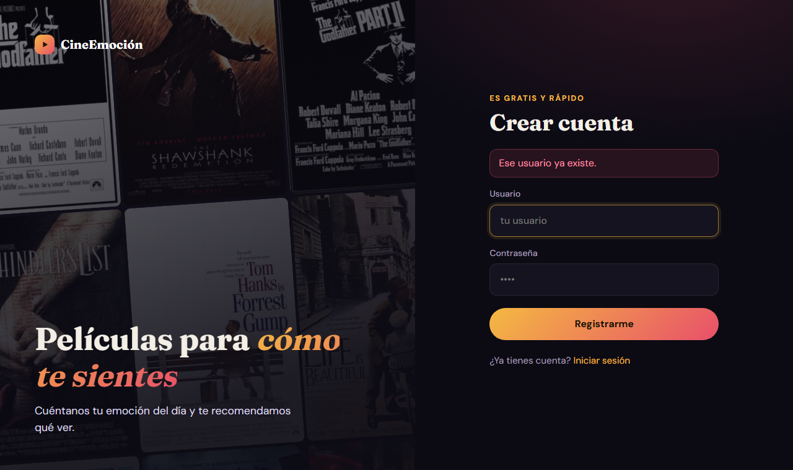

### 3. Cuestionario "¿Cómo te sientes hoy?" (`/hoy?u=<usuario>`)
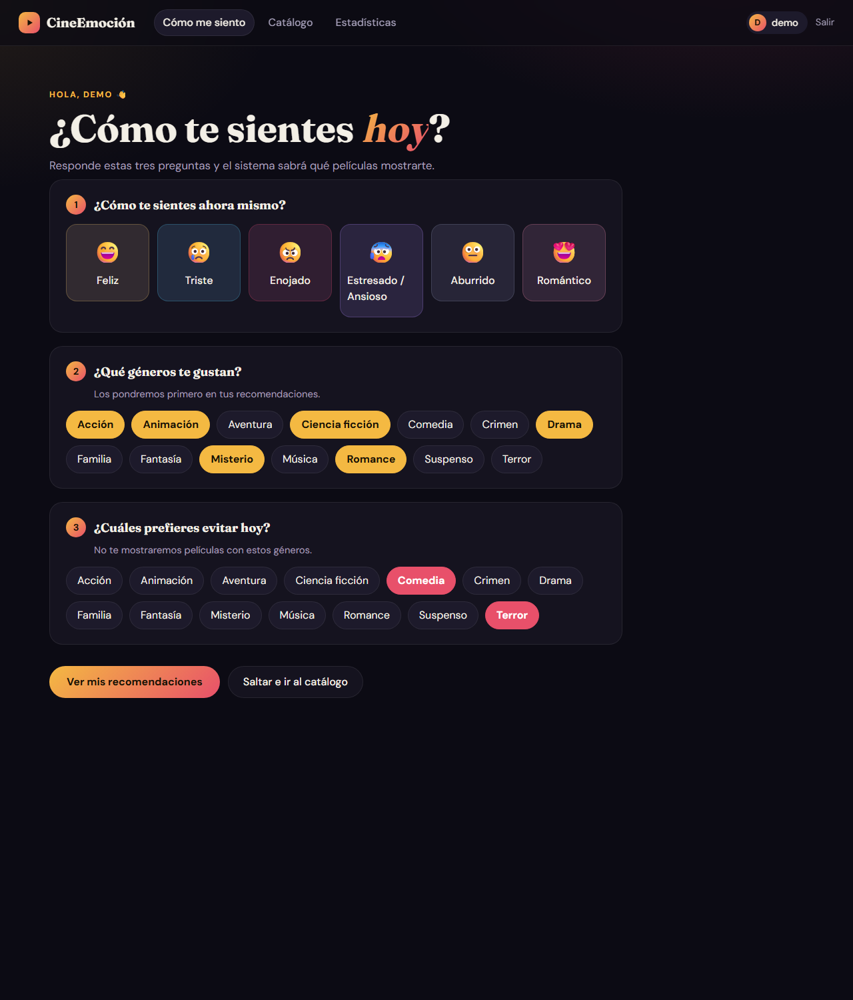

Es lo primero que ve el usuario al entrar. Son tres preguntas de opción:
1. **¿Cómo te sientes ahora mismo?**: una de las 6 emociones (Feliz, Triste, Enojado, Estresado/Ansioso, Aburrido, Romántico).
2. **¿Qué géneros te gustan?**: se priorizan en sus recomendaciones.
3. **¿Cuáles prefieres evitar hoy?**: las películas con esos géneros no se le muestran.

Las respuestas se **guardan como preferencias del usuario** (aparecen marcadas la próxima vez) y un género no puede estar en "me gusta" y en "evitar" a la vez. Al enviar, se registra la emoción en su historial y se muestran sus recomendaciones. Con "Saltar" se va directo al catálogo.

### 4. Recomendaciones personalizadas (`/recomendar`)
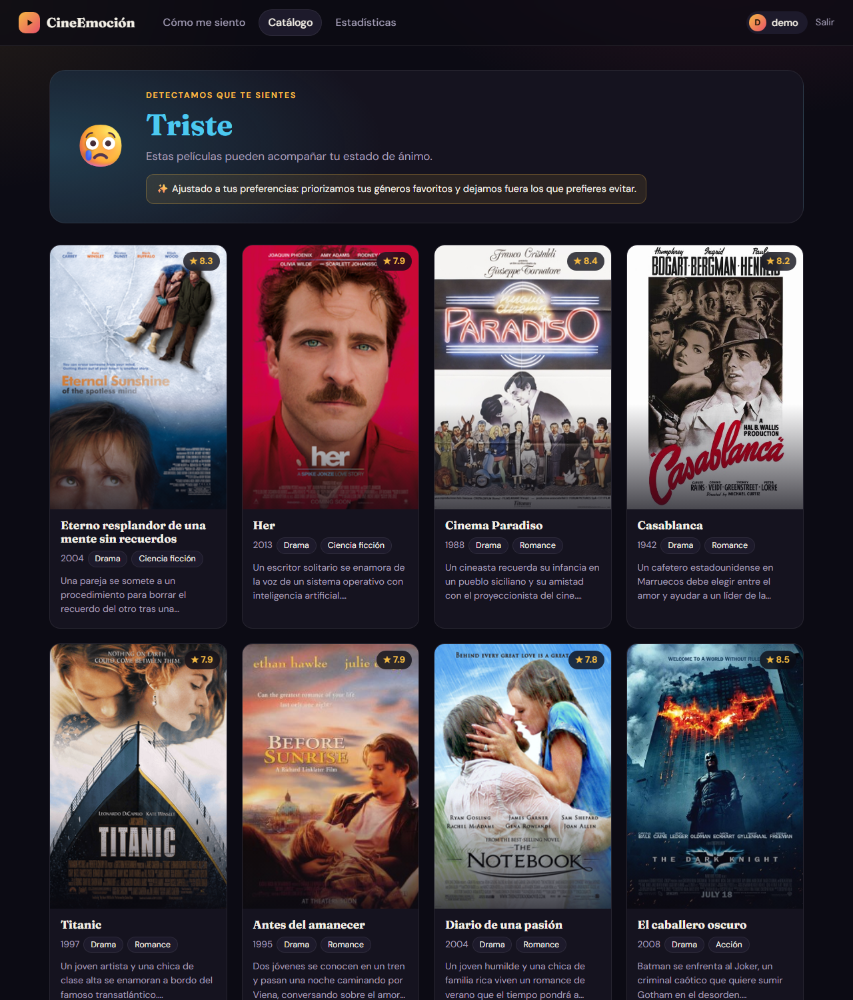

Muestra la emoción elegida con su color y las películas sugeridas. Las películas se ordenan por cuántos géneros de la emoción comparten; si el usuario tiene preferencias, **cada género que le gusta suma puntos y las películas con géneros que evita se descartan** (se indica con el aviso "Ajustado a tus preferencias"). Cada consulta queda guardada en el historial **del usuario**.

### 5. Catálogo (`/catalogo`)
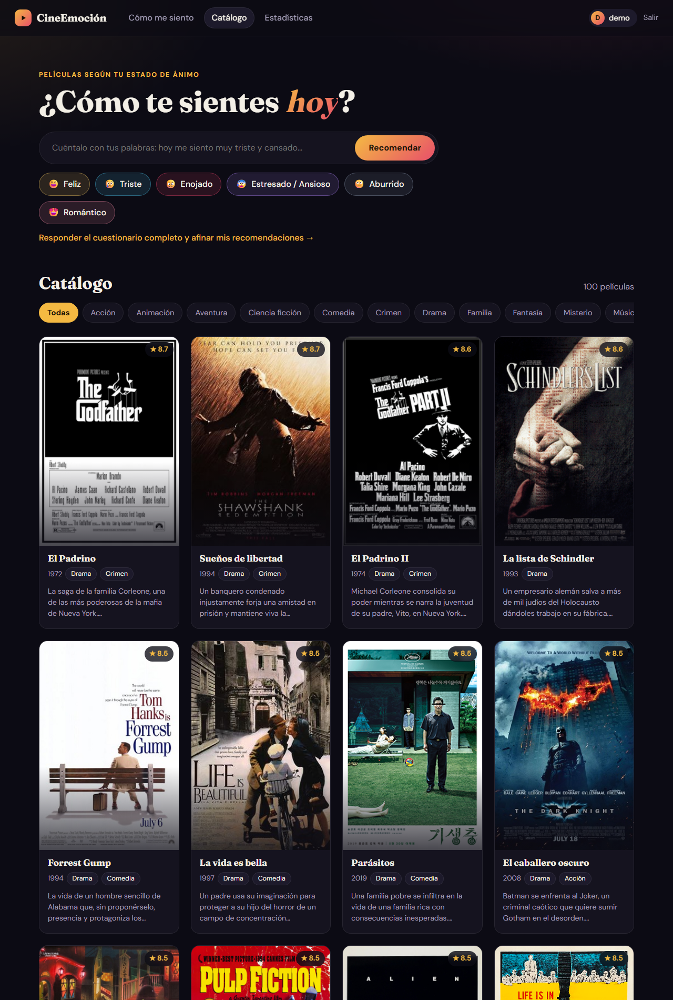

Catálogo de las 100 películas ordenadas de mejor a peor puntuación, paginado de 12 en 12, con tarjetas de póster, nota, año, géneros y sinopsis. Arriba tiene el campo de texto libre ("hoy me siento muy triste y cansado"), atajos de un clic para cada emoción y un acceso al cuestionario completo. Los géneros funcionan como filtros:

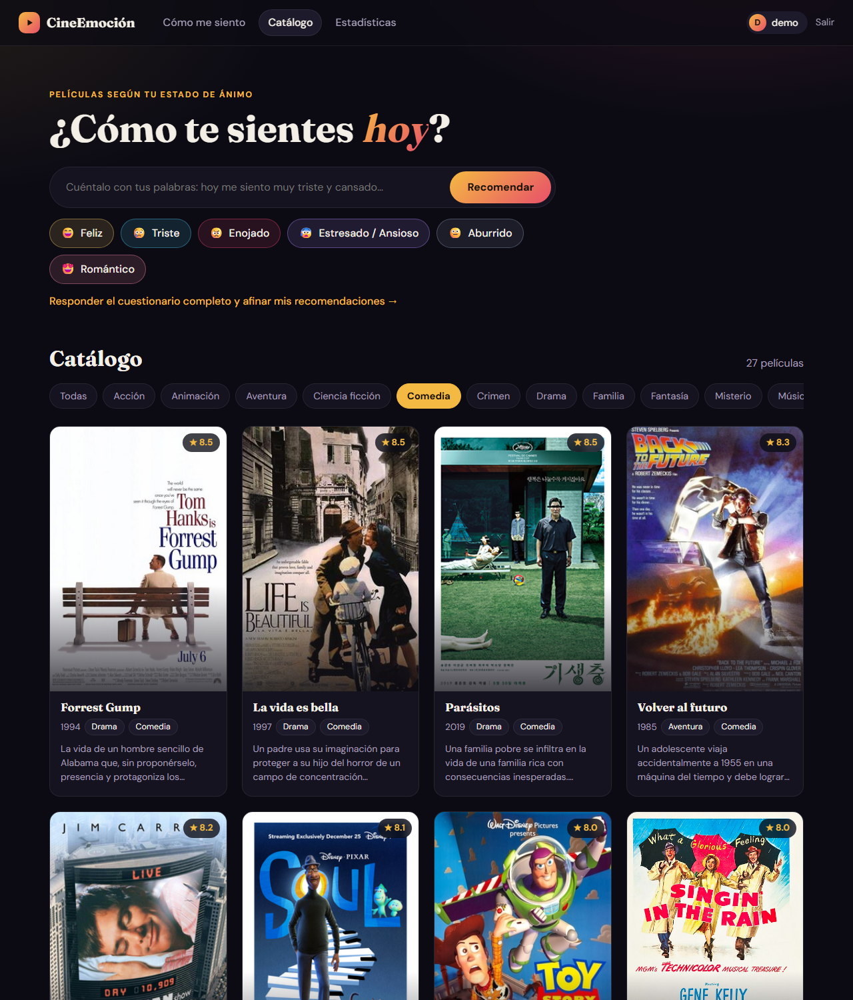

### 6. Detalle de película (`/pelicula/<id>`)
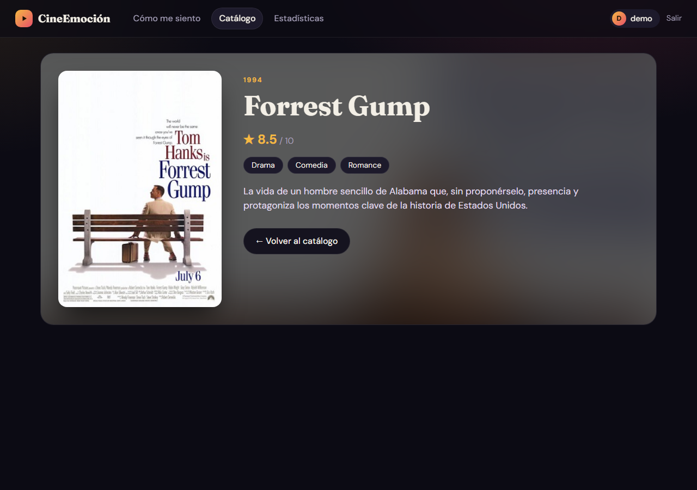

Póster grande sobre un fondo difuminado con sus colores, título, año, nota sobre 10, géneros y sinopsis completa.

### 7. Estadísticas del usuario (`/estadisticas?u=<usuario>`)
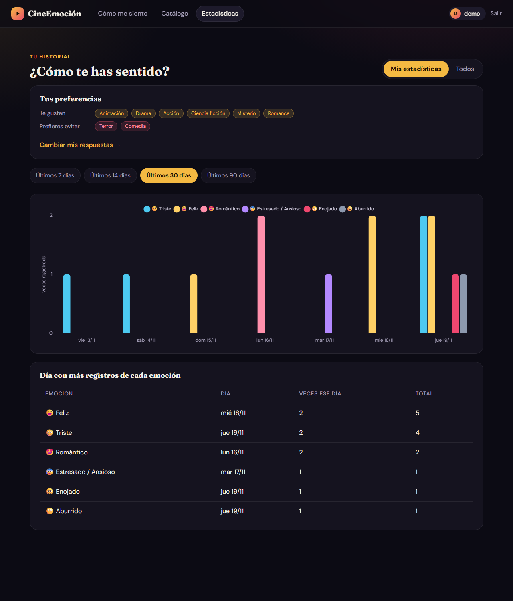

Relaciona el **historial y las preferencias de cada usuario**: muestra sus géneros favoritos y los que evita (con un enlace para cambiarlos), un gráfico de barras con las veces que registró cada emoción por día y una tabla con el día con más registros de cada una. Se puede cambiar el periodo (7, 14, 30 o 90 días).

La pestaña **Todos** muestra las estadísticas de todos los usuarios:

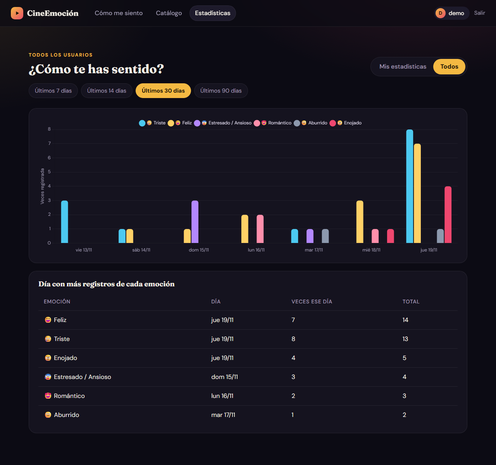

> **Identificación del usuario:** no hay cookies ni sesión; el nombre viaja en la URL (`?u=demo`) y todos los enlaces lo conservan. Es simple pero **no es seguro**: cualquiera puede cambiar el `u` de la URL y ver o editar los datos de otro usuario. Sirve para un proyecto universitario o una demo. El botón **Salir** vuelve al login.

## Modelo de datos y JOINs
```
movies ──< movie_genres >── genres ──< emotion_genres >── emotions ──< searches >── users
                                  genres ──< user_genres >── users
```
- **Catálogo**: `movies JOIN movie_genres JOIN genres` (géneros de cada película).
- **Recomendación**: `emotions JOIN emotion_genres JOIN movie_genres JOIN movies`,
  ordenado por cantidad de géneros coincidentes y puntuación.
- **Estadísticas**: `searches JOIN emotions` + `GROUP BY` día y emoción (gráfico de barras), filtrable por usuario (`searches.user_id`).
- **Preferencias**: `user_genres` guarda, por usuario, los géneros que le gustan o evita; la recomendación las usa para ordenar y para excluir películas.

## Cómo ejecutarlo
1. Base de datos: `docker compose up -d`
   (o con MySQL local: cargar en orden `backend/sql/schema.sql`, `seed.sql`, `seed_extra.sql`, `seed_extra2.sql`, `seed_extra3.sql`, `seed_users.sql`, `seed_posters.sql`)
2. Entorno Python (una sola vez):
   ```bash
   python3 -m venv venv && source venv/bin/activate
   pip install -r requirements.txt
   cp backend/.env.example backend/.env      # ajusta usuario/clave de MySQL
   cp frontend/.env.example frontend/.env
   ```
3. Backend (terminal 1):  `cd backend && python app.py`   → http://127.0.0.1:5001
4. Frontend (terminal 2): `cd frontend && python app.py`  → **http://127.0.0.1:5000** (pantalla de login; el catálogo queda en `/catalogo`)

## Endpoints del backend
| Método | Ruta | Descripción |
|---|---|---|
| GET | `/api/peliculas?skip=0&limit=12&genero=35` | catálogo paginado (`total`, `tiene_mas`, `items`) |
| GET | `/api/peliculas/<id>` | detalle de una película |
| GET | `/api/generos`, `/api/emociones` | listas auxiliares |
| POST | `/api/recomendar` | `{"texto": "estoy triste"}` o `{"emocion": "triste"}`, más `"usuario"` opcional (personaliza y guarda en su historial) |
| GET | `/api/recomendar/<emocion>` | recomendación sin guardar historial |
| POST | `/api/emocion` | `{"texto": "..."}` → emoción detectada |
| GET | `/api/estadisticas?dias=30&usuario=demo` | datos para el gráfico por día (`usuario` es opcional: solo sus búsquedas) |
| GET / PUT | `/api/usuarios/<usuario>/preferencias` | `{"gusta": [ids], "evita": [ids]}`; el PUT reemplaza las preferencias |
| POST | `/api/registro`, `/api/login` | `{"usuario": "...", "password": "..."}` (409 si el usuario ya existe, 401 si las credenciales fallan) |

Rate limit: 60–120 peticiones por minuto por IP (responde `429` con `Retry-After`).

## Pósters
Las imágenes ya están descargadas en `backend/static/posters/` y la tabla `movies` guarda su ruta en `poster_url`.

## Datos de ejemplo para el gráfico (opcional)
`backend/sql/seed_demo_busquedas.sql` inserta búsquedas ficticias (`[demo]`).
Para borrarlas: `DELETE FROM searches WHERE text LIKE '[demo]%';`

## Login y usuarios
Usuario precargado: **demo** / **demo1234** (con preferencias e historial de ejemplo). Desde `/registro` se pueden crear más; no permite usuarios repetidos.
`backend/sql/seed_demo_busquedas.sql` (opcional) agrega búsquedas de ejemplo, incluidas las del usuario `demo`.
